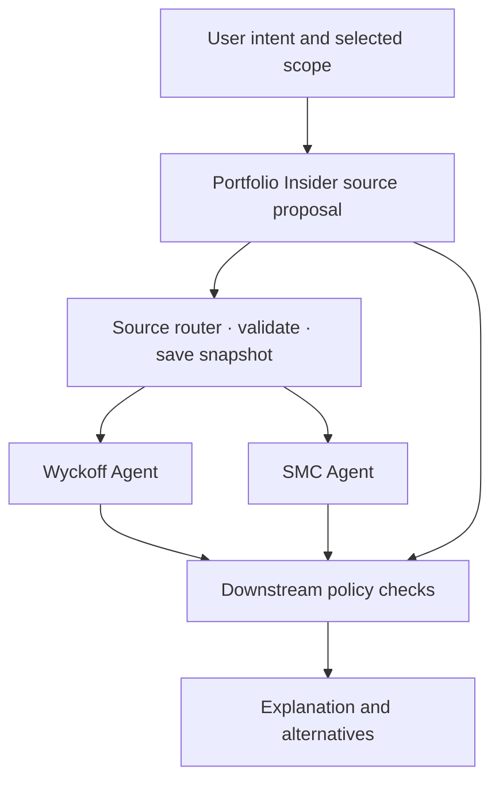

# Portfolio-led intake and independent market agents

## Canonical architecture

The old Binance hackathon orchestrator combined Wyckoff and SMC in one agent.
Decision Check instead has two independent analysis agents. Their reusable
upstream logic is retained, but neither agent consumes the other's report.
Independence does not imply statistically independent evidence: both analyze
the same market history and may detect correlated features.



The source path is mandatory. Missing, invalid or mismatched data blocks both
analysis agents. Each receives an isolated copy with the SAME snapshot hash,
venue, product, symbol and cutoff. One agent failing leaves its result UNKNOWN;
it cannot be inferred from the successful agent. Policy checks must distinguish
UNKNOWN from a valid negative result. No order is placed.

## Source-plan contract

Portfolio Insider will recommend a plan containing:

- User intent: BUY_SPOT, REVIEW_SPOT, OPEN_FUTURES or REVIEW_FUTURES.
- Selected instrument(s), market product and venue.
- Why the instrument is in scope: selected holding or explicit user request.
- Required market dataset and the private portfolio coverage needed for risk.
- Intended source, cutoff, missing information and source availability.

Today `propose_source` is a deterministic planning interface accepting those
explicit selections, NOT an autonomous Portfolio Insider agent. Only Binance
USDT Spot and USD-M market collectors are implemented. Unsupported venues or
products fail explicitly; no spot/futures/venue substitution is allowed. The
plan fields are not authentication or a proof of user authorization. A future
service must bind them to its authenticated request/account scope.

Reading other positions for total portfolio risk is different from running
technical analysis on every asset. Wyckoff/SMC run only on selected holdings or
explicitly requested instruments. No global market scan is part of this path.
Cash/stablecoin-only portfolios do not trigger analysis of arbitrary coins.

## Implemented Python interface

```python
from decision_check.intake import propose_source, run_plan

plan = propose_source(
    venue='BINANCE', market='SPOT', symbol='BTCUSDT', intent='BUY_SPOT',
    requested_symbols=['BTCUSDT'],
)
report = run_plan(plan, db_path='decision-check.sqlite3')
```

`run_plan` fetches once, validates source binding and closed-candle integrity,
persists the snapshot, and invokes WyckoffAgent and SMCAgent independently.
The current implementation invokes them sequentially for simple local operation;
there is no logical dependency between them and concurrency is not required for
independence. A collector can be injected for testing or another approved
transport. Production identity, credentials, quotas and multi-user storage are
not implemented by this interface.

Output schema: `decision-check.independent-agents.v1`. Each report includes an
agent ID, upstream revision, snapshot hash, ANALYZED/UNKNOWN and evidence.
ANALYZED means analysis ran, not that buy conditions passed. No Boolean market
approval is fabricated. Existing v1 combined reports and the hosted report
reader are legacy plumbing and are not silently relabeled as this new schema.

## Proposed circuit separation

Wyckoff-derived checks, SMC-derived checks and portfolio quantitative checks
will be specified separately and can later be composed. The agents prepare
features and reasons; they are not themselves TapeOut circuits. Which features
are extracted offchain and which comparisons are executed inside each circuit
must be explicit. No circuit IDs, deployment or onchain verification are claimed.

## Acceptance evidence

The test suite verifies scope rejection, intent/product binding, unsupported
source rejection, data gating before either agent, one fetch per plan, persistence
before analysis, input isolation, matching snapshot hashes and one-agent failure
without suppressing the other. Existing snapshot/replay tests remain in place.

## Next implementation boundary

Finish the actual Portfolio Insider intake (manual/file/read-only source adapters,
coverage, selected instrument mapping and user intent) before presenting this as
an end-to-end customer workflow. Then expose an authenticated report service and
migrate the three-language UI to the independent-agent schema. TapeOut numeric
rule design and deployment follow those stable input/output contracts.

## Portfolio brain implementation update

`decision_check/portfolio_insider` now implements offline self-reported snapshot
analysis and explicit market-data requests. See `agents/portfolio-insider/BRAIN.vi.md`.
It does not yet automatically execute `run_plan` or authenticate supplied evidence.
The adapter remains responsible for mapping validated snapshot evidence into the
brain's report contract. Fixed upstream H4/H1 analysis must not be presented as
full support for the requested CYCLE/SWING/INTRADAY profiles.
